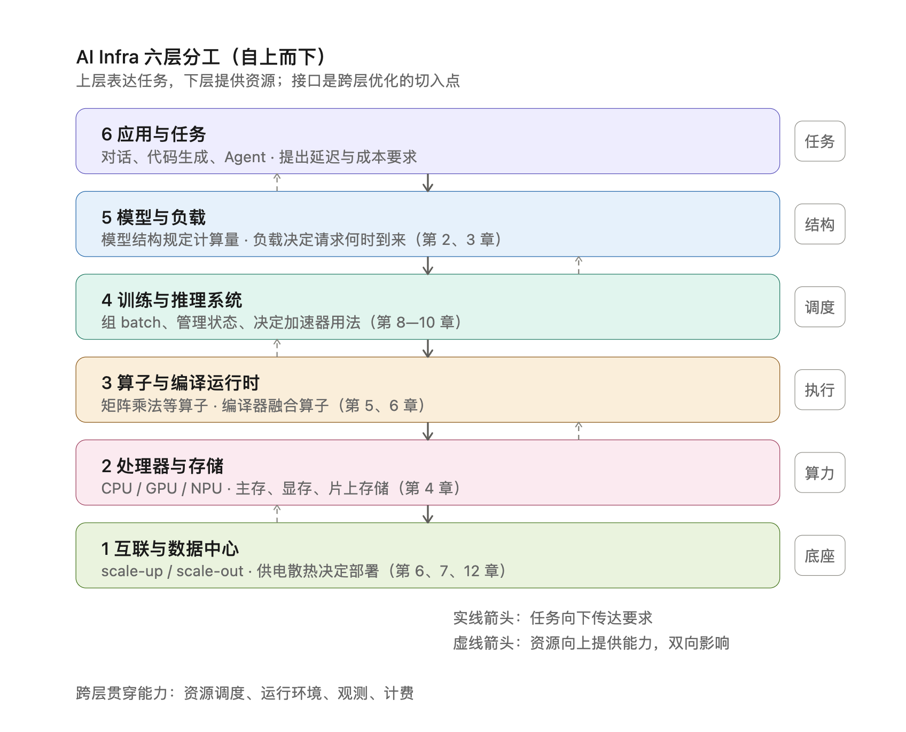
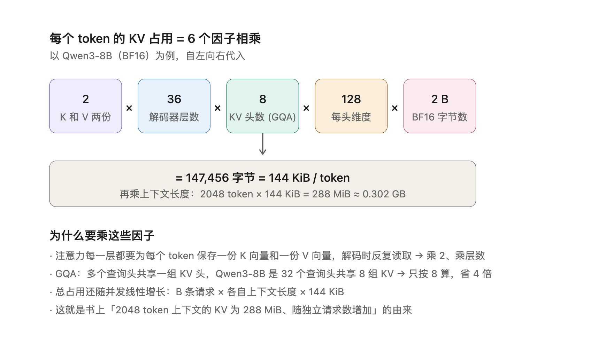
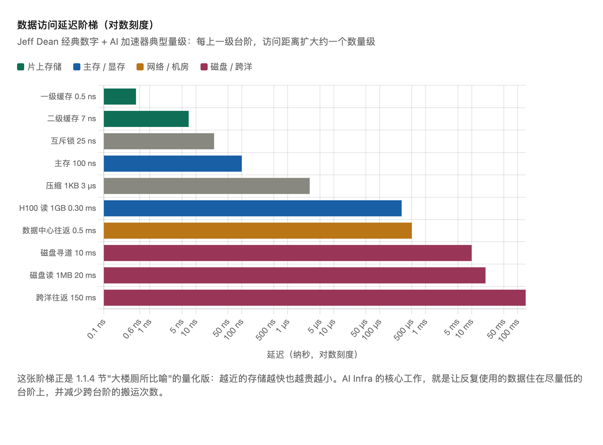

---  
title: AI Infra 初识 — 基础概念及关键数字认知  
description: 从六层分工建立全景认知，梳理上下文、prefill/decode、KV 缓存等核心概念与容量—带宽—算力分析方法论，沉淀延迟阶梯、GPU 规格。  
date: 2026-10-15T15:30:00+08:00  
math: true  
license: CC BY-NC-SA 4.0  
comments: true  
categories:  
    - AI Infra  
tags:  
    - 阅读  
    - 基础概念  
    - 性能分析  
    - LLM  
---

AI Infra 是支撑 AI 训练和推理的基础设施：计算设备、存储与互联，以及组织这些资源的软件。一句话概括其主线——**数据搬移塑造了 AI Infra 的架构**。下面先建立分层全景，再梳理核心概念，最后沉淀值得记住的关键数字。

---

## 一、关键基础概念

### 1.1 六层分工：先建立全景

AI Infra 划分为六个层次：应用与任务、模型与负载、训练与推理系统、算子与编译运行时、处理器与存储、互联与数据中心。上层表达任务，下层提供资源，**接口即优化切入点**：模型改变状态表示→改变存储和通信需求；编译器融合相邻算子→改变中间结果存放位置；运行时让加速器直接交接→减少主机参与。

### 1.2 应用与模型侧

| 概念                     | 定义                         | 一句话理解                          |
| ---------------------- | -------------------------- | ------------------------------ |
| **上下文**                | 本次模型调用可用的输入：任务指令、参考材料、历史交互 | 不改参数、只改上下文就能改变任务——新的可编程入口      |
| **工具**                 | 供应用调用的程序功能                 | 模型决定下一步做什么，宿主程序执行——Agent 的基本结构 |
| **token**              | 模型处理文本的基本单位                | 文本进模型前先切成 token 序列             |
| **模型权重**               | 训练得到的数值参数，把输入变换成输出         | 启动时从存储加载，之后**驻留**显存            |
| **batch / batch size** | 合并计算、共用一次权重读取的请求数          | 提吞吐的关键旋钮，但会拉长单请求延迟             |

其中最重要的是**编程抽象上移**：传统应用用代码表达行为，模型驱动的应用增加了第二个入口——通过选择模型、组织上下文和提供工具来表达任务。一部分原来逐条编写规则的行为，改由模型根据上下文决定。上层可编程性的变化，为跨层联合优化打开了新的空间。

### 1.3 执行流程：一次请求的旅程

- **推理实例**：独立完成模型请求的一组执行资源；**服务路由器**决定请求去哪个实例
- **prefill（预填充）**：一次性处理全部输入 token——算力密集
- **decode（解码）**：逐个生成新 token——带宽密集（每步都要读全部权重和旧 KV）
- **KV 缓存**：保存每个 token 产生的 K/V 向量供后续注意力复用，随上下文线性增长
- **两类数据搬移**：**加载**（模型→显存，一次）vs **执行**（反复把数据送计算单元）

一个反直觉的事实：外部请求可能只有一小段文字，内部搬移的数据却包括大得多的权重、状态和中间张量。

### 1.4 硬件组织

- **scale-up（纵向扩展）**：超节点内部高带宽互联（如 NVLink），低开销共同计算
- **scale-out（横向扩展）**：超节点之间经网卡与交换网络相连，扩大集群范围
- **超节点**：一组紧密协作的加速器（例：NVIDIA GB200 NVL72 = 36 CPU + 72 GPU 一柜）
- **HBM / PCIe / DMA**：加速器显存、CPU-GPU 连接、直接内存访问

### 1.5 分析方法论：公式与解释

分析任何 AI 系统的固定顺序：**先容量，再需求，算下界，实测对比，评估收益**。

**容量检查**

$M_W + M_{\mathrm{state}} + M_{\mathrm{work}} \le M_{\mathrm{cap}}$

权重 + 上下文状态（KV）+ 工作区（中间张量）≤ 可用显存。数据放不下，一切性能讨论都没有意义，所以永远先做这一步。

**三个量的教学模型**

$M_W = b_W N, \qquad R_W = b_W N, \qquad F \approx 2BN$

decode 每步让全部参数过一遍总线（缓存放不下几十 GB 的权重），所以**存储量 = 读取量**；矩阵与向量相乘中每个权重参与一次乘法一次累加（计 2 次浮点运算），batch 内 $B$ 条请求共用矩阵计算，运算量乘 $B$ 而**权重读取不变**——这就是批内复用的本质。

**时间下界（重叠执行模型）**

$T_{\mathrm{step}} \ge T_{\mathrm{lower}} = \max\left(\frac{F}{\Pi},\ \frac{R_W}{\beta}\right)$

数据分块到达时计算与读取可以重叠，总时间不小于两者中较慢的一个。按峰值算出的这个值是**硬件物理极限**，任何实现都不可能超越。

**算例**（70B @ H100 SXM，$B=1$，1 byte/参数）：

$\frac{R_W}{\beta} = \frac{70\ \text{GB}}{3350\ \text{GB/s}} \approx 20.90\ \text{ms}, \qquad \frac{F}{\Pi} = \frac{140\ \text{GFLOPs}}{989400\ \text{GFLOP/s}} \approx 0.1415\ \text{ms}$

**读取下界是计算下界的约 148 倍**——decode 是带宽受限的，此时提高算力对时间下界毫无影响，提高带宽、量化权重或增大 batch 才有效。

**MFU 与 MBU**

$\mathrm{MFU} = \frac{F}{\Pi\, T}, \qquad \mathrm{MBU} = \frac{R}{\beta\, T}$

把实测时间 $T$ 代回下界公式得到利用率：$\Pi T$ 是硬件最多能算的量，$\beta T$ 是最多能搬的量。两者都**不超过 1**，据此诊断差距来源：

- 算出 **> 1**：$F$ 或 $R$ 估少了——理论模型漏项，该修模型
- **远小于 1**：硬件在空转——系统开销，该修实现

**算例**：Qwen3-8B 一步 decode 读取下界 8.62 ms，batch=1 实测 26.5 ms，MBU = 8.62/26.5 ≈ **33%**。排查：关掉逐步日志降到 12.1 ms，仅按加速器事件计时为 10.7 ms——三倍差距主要是 eager 模式下主机侧逐个提交 kernel 的空转开销，不是硬件不够快。

**Amdahl 定律**

$\mathrm{Speedup} = \frac{1}{(1 - f) + f/s}$

$f$ 为可加速部分占原时间的比例，$s$ 为该部分的加速倍数。两个推论：只有 $f$ 接近 1 才能拿到全部加速；哪怕 $s \to \infty$，总收益也被 $1/(1-f)$ 封顶。

**算例**（AI 编程工具，编码提速 5 倍）：大公司团队编码占 20%–30%，整体加速比仅约 1.19–1.32 倍；创业团队编码占 70%–80%，可达约 2.27–2.78 倍。Amdahl 定律适用于任何只加速部分环节的完整流程。

**转折点 batch size**——令计算时间等于读取时间：

$B_\ast = \frac{b_W\, \Pi}{2\beta} \approx 147.7$

batch 低于 $B_\ast$ 带宽受限，高于它算力受限。但此式未计入 KV：H100 放下 73.73 GB 权重后只剩约 6.27 GB，装不下 148 条请求的 KV——**容量先于算力成为约束**。

**算术强度**——每次搬运支撑多少计算：

$I = \frac{F}{R_W} = \frac{2B}{b_W}$

与机器平衡点 $\Pi/\beta$ 比较：$I < \Pi/\beta$ 带宽受限，反之算力受限——第 4 章 Roofline 模型的出发点。

**补全模型（计入 KV 状态）**——实测发现 batch 增大后注意力计算和上下文访问不可忽略，修正为：

$T_{\mathrm{step}} \approx \max\left(\frac{B F_1}{\Pi},\ \frac{R_W + B\, R_{\mathrm{state},1}}{\beta}\right)$

$R_W$ 不随 $B$ 增长（权重读一次全员复用），$B R_{\mathrm{state},1}$ 随 $B$ 线性增长——权重复用越来越划算，上下文访问逐渐成为新的带宽负担。

### 1.6 KV 缓存占用计算

注意 GQA 的作用：32 个查询头共享 8 组 KV，只按 8 算，比传统 MHA 省 4 倍。KV 的真正杀伤力在于它进入容量预算后**随并发数线性增长**：100 条 2048 token 并发就是约 30 GB，是权重之外的隐性大头。

---

## 二、关键数字

### 2.1 访问延迟阶梯（Jeff Dean, 2009）

越近的存储越快、也越贵越小。AI Infra 的核心工作就是让反复使用的数据住在尽量低的台阶上，并减少跨台阶的搬运次数。

### 2.2 GPU 资源速查（BF16 / FP32 稠密峰值）

|             | RTX 4090      | A100 80GB SXM | H100 SXM      |
| ----------- | ------------- | ------------- | ------------- |
| 显存容量        | 24 GB         | 80 GB         | 80 GB         |
| 显存带宽        | 1.008 TB/s    | 2.039 TB/s    | 3.35 TB/s     |
| BF16 矩阵峰值   | 165.2 TFLOP/s | 312 TFLOP/s   | 989.4 TFLOP/s |
| 按带宽峰值读 1 GB | 0.99 ms       | 0.49 ms       | 0.30 ms       |

### 2.3 必须记住的换算与量级

- **70B BF16 权重 ≈ 141 GB**（每参数 2 字节）→ 单张 H100 放不下；8 比特量化后 ≈ 73.7 GB 勉强一张，剩余 6.27 GB 决定了并发上限
- **decode 每步运算量 ≈ 2N，权重读取 ≈ N 字节**（1 byte/参数时）
- **70B @ H100 一步 decode：读取 20.9 ms vs 计算 0.14 ms，差 148 倍**——带宽受限是 decode 的常态
- **转折点 $B^\ast \approx 148$**：batch 过此线才轮到算力做瓶颈
- **网络换算**：400 Gbit/s = 50 GB/s，传 1 GB 需 20 ms（8 bit = 1 byte）
- **寻道算例**：串行 20 次寻道 + 1 ms 计算 = 201 ms；计算提速翻倍只省 0.5 ms，数据连续放置省 100 ms——某部分占比越大，缩短它对整体改善越大

### 2.4 Qwen3-8B 实测速查（BF16，RTX PRO 6000 Blackwell 96 GB / 1.792 TB/s / 503.8 TFLOP/s，vLLM eager）

| 量                       | 数值                            |
| ----------------------- | ----------------------------- |
| 完整 BF16 权重              | 16.38 GB                      |
| 每 token 全模型 KV          | 144 KiB                       |
| 2048 token 上下文 KV       | 288 MiB ≈ 0.302 GB            |
| 2048 token prefill 矩阵运算 | 29.69 TFLOPs（下界 ≈ 58.9 ms）    |
| 一步 decode 矩阵运算          | 16.34 GFLOPs（下界 ≈ 0.0324 ms）  |
| 一步 decode 权重读取          | 15.14 GB                      |
| 一步 decode 旧 KV 读取       | 0.302 GB                      |
| 读取下界                    | 8.62 ms                       |
| batch=1 实测 TPOT         | 26.5 ms → MBU 33%             |
| batch 1→64              | 吞吐提约 31 倍；TPOT 26.5 → 40.5 ms |

**吞吐与延迟的分离**：批内复用减少分摊开销、提高吞吐，但每个请求仍须经历排队和整批执行——两者应同时报告。
